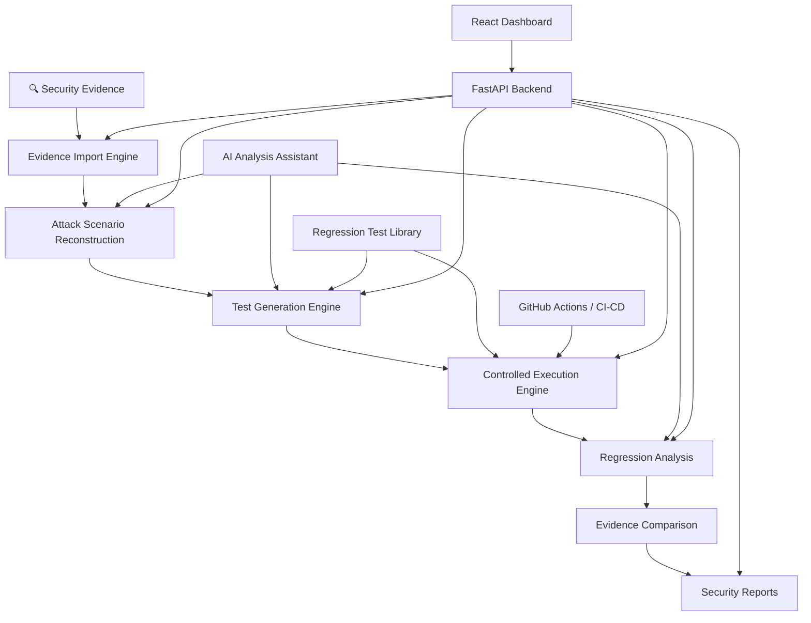

# ⚡ VulnReplay

### Reproduce. Verify. Prevent.

**Turn every security finding into a permanent, repeatable security test.**

<p align="center">


</p>

---

## 🛡️ What is VulnReplay?

**VulnReplay** is an open-source application security testing platform that transforms vulnerability findings into reusable, automated security regression tests.

Security teams discover vulnerabilities, fix them and move on. But what happens when a future update accidentally introduces the same vulnerability again?

VulnReplay aims to solve this problem.

Import security evidence, reconstruct the original attack scenario, generate reproducible tests and verify whether the vulnerability has actually been fixed.

**Don't just fix vulnerabilities. Make sure they never return.**

---

## 🎯 The Problem We're Solving

Imagine a penetration tester discovers an IDOR vulnerability in an application.

The development team fixes it. The security team verifies the patch. Everything looks good.

Three months later, a new API update accidentally breaks the authorization logic.

The same vulnerability returns.

This is exactly the kind of problem VulnReplay is designed to prevent.

| Traditional workflow | VulnReplay workflow |
|---|---|
| Discover vulnerability | Import vulnerability evidence |
| Manually reproduce | Reconstruct attack scenario |
| Fix the vulnerability | Generate reusable regression test |
| Manually verify patch | Automatically compare behavior |
| Close the security ticket | Preserve test permanently |
| Risk recurrence | Continuously validate security |

---

## ⚡ Core Capabilities

### 🔍 01. Evidence Intelligence

Import security evidence from multiple sources.

- Burp Suite-compatible HTTP exports
- OWASP ZAP reports
- HAR files
- JSON and SARIF reports
- Raw HTTP requests and responses
- Structured incident logs

Extract endpoints, methods, parameters, authentication context and response information.

### 🧠 02. Attack Scenario Reconstruction

Transform security evidence into structured attack scenarios.

- Identify affected endpoints.
- Extract request sequences.
- Understand authentication contexts.
- Identify vulnerable parameters.
- Preserve reproduction steps.
- Organize supporting evidence.

### ⚙️ 03. Automated Test Generation

Turn discovered vulnerabilities into reusable security tests.

- Python HTTPX tests
- Pytest test cases
- Playwright browser tests
- Parameterized test definitions
- Reusable regression templates

### 🔥 04. Vulnerability Regression Detection

The heart of VulnReplay.

Compare application behavior before and after remediation.

Detect:

- Broken access control
- IDOR / BOLA
- Authentication regressions
- Authorization bypass
- Missing security headers
- Rate-limiting regressions
- CORS misconfigurations
- Unexpected data exposure

### 🔄 05. Multi-Step Attack Replay

Reconstruct complex application workflows.

Example:

```text
User A authenticates
       |
       v
Accesses personal resource
       |
       v
User B authenticates
       |
       v
Attempts to access User A's resource
       |
       v
Authorization behavior verified
       |
       v
Security regression result generated
```

### 🤖 06. AI-Assisted Security Analysis

An optional AI assistant helps security engineers:

- Understand vulnerability evidence.
- Explain request/response behavior.
- Suggest safe verification tests.
- Generate structured test definitions.
- Explain regression findings.
- Recommend remediation improvements.

AI-generated findings must always be supported by actual evidence.

### 📚 07. Regression Test Library

Build a permanent collection of security knowledge.

- Save discovered vulnerabilities.
- Version test cases.
- Categorize security scenarios.
- Track previous executions.
- Compare historical results.
- Reuse tests across deployments.

### 🚀 08. CI/CD Security Integration

Bring security regression testing into development workflows.

- GitHub Actions integration
- Pull-request security checks
- Automated regression execution
- JSON and SARIF reports
- Configurable deployment policies

---

## 🖥️ Product Preview

> Replace these placeholders with screenshots of your actual running application.

| Dashboard | Vulnerability Analysis |
|---|---|
|  |  |
| *Security overview* | *Evidence investigation* |

| Attack Replay | Regression Results |
|---|---|
|  |  |
| *Attack reconstruction* | *Before/after comparison* |

---

## 🏗️ System Architecture



---

## 🧰 Technology Stack

| Layer | Technologies |
|---|---|
| Backend | Python, FastAPI |
| Frontend | React, TypeScript, Vite |
| Styling | Tailwind CSS |
| Database | PostgreSQL |
| ORM | SQLAlchemy |
| Migrations | Alembic |
| HTTP Testing | HTTPX |
| Browser Testing | Playwright |
| Test Framework | Pytest |
| AI Integration | Optional local LLM |
| Deployment | Docker, Docker Compose |
| CI/CD | GitHub Actions |

---

## 📁 Project Structure

```text
VulnReplay/
│
├── backend/
│   ├── app/
│   │   ├── api/
│   │   ├── core/
│   │   ├── services/
│   │   ├── models/
│   │   ├── schemas/
│   │   ├── security/
│   │   └── main.py
│   │
│   └── tests/
│
├── frontend/
│   └── src/
│       ├── components/
│       ├── pages/
│       ├── services/
│       ├── hooks/
│       └── types/
│
├── examples/
│   ├── vulnerable-app/
│   └── patched-app/
│
├── docs/
│   ├── ARCHITECTURE.md
│   ├── THREAT_MODEL.md
│   ├── TESTING.md
│   └── API_REFERENCE.md
│
├── .github/
│   └── workflows/
│
├── docker-compose.yml
├── .env.example
├── CONTRIBUTING.md
├── SECURITY.md
├── CHANGELOG.md
├── LICENSE
└── README.md
```

---

## 🚀 Getting Started

### Prerequisites

- Python 3.11+
- Node.js 20+
- PostgreSQL
- Git
- Docker (recommended)

### 1. Clone the repository

```bash
git clone https://github.com/YOUR_USERNAME/vulnreplay.git

cd vulnreplay
```

### 2. Configure the backend

```bash
cd backend

python -m venv venv
```

Activate the environment.

**Windows:**

```powershell
venv\Scripts\activate
```

**Linux / macOS:**

```bash
source venv/bin/activate
```

Install dependencies:

```bash
pip install -r requirements.txt
```

Configure environment variables using the provided `.env.example`.

### 3. Start the backend

```bash
uvicorn app.main:app --reload
```

API:

```text
http://localhost:8000
```

Interactive API documentation:

```text
http://localhost:8000/docs
```

### 4. Start the frontend

Open another terminal:

```bash
cd frontend

npm install

npm run dev
```

Frontend:

```text
http://localhost:5173
```

### 5. Start with Docker

From the project root:

```bash
docker compose up --build
```

---

## 🧪 Testing & Quality Assurance

VulnReplay is designed around reproducible security testing.

The test suite should cover:

| Test category | Objective |
|---|---|
| Unit tests | Validate individual components |
| Integration tests | Verify module interactions |
| API tests | Validate backend endpoints |
| E2E tests | Verify complete workflows |
| Security tests | Test platform security controls |
| Regression tests | Detect previously fixed vulnerabilities |

Run backend tests:

```bash
cd backend
pytest
```

Run frontend tests:

```bash
cd frontend
npm test
```

Run the production build:

```bash
npm run build
```

Run Python linting:

```bash
ruff check .
```

Test results should be published only after actual execution.

---

## 🔐 Security First

VulnReplay is designed for authorized application security testing.

Security controls include:

- Explicit target authorization.
- Target allowlisting.
- SSRF and DNS rebinding protection.
- Request rate limiting.
- Secure credential management.
- Safe evidence handling.
- Execution timeouts.
- Audit logging.
- Human approval for AI-generated tests.
- No execution of uploaded scripts.

**Never test systems without appropriate authorization.**

---

## 🗺️ Roadmap

- [ ] Evidence import engine
- [ ] HTTP request/response parser
- [ ] Attack scenario reconstruction
- [ ] Security test generation
- [ ] Vulnerability regression engine
- [ ] Multi-step attack replay
- [ ] IDOR and authorization verification
- [ ] AI-assisted security analysis
- [ ] Regression test library
- [ ] Professional security dashboard
- [ ] GitHub Actions integration
- [ ] Burp Suite-compatible integration
- [ ] OWASP ZAP integration
- [ ] SARIF reporting
- [ ] Docker deployment
- [ ] Complete security audit

---

## 🤝 Contributing

Contributions are welcome!

Areas where developers and security researchers can contribute:

- New vulnerability test templates
- Additional evidence formats
- Regression detection improvements
- Security integrations
- Test execution improvements
- Documentation and testing

Please read [CONTRIBUTING.md](CONTRIBUTING.md) before submitting a pull request.

---

## 📜 License

Distributed under the MIT License.

See [LICENSE](LICENSE) for more information.

---

## ⚠️ Disclaimer

VulnReplay is intended for authorized security testing, application security research and remediation verification.

It does not guarantee that an application is completely free of vulnerabilities.

All testing must be conducted against systems for which appropriate authorization has been obtained.

---

## 💡 Project Philosophy

**A vulnerability should not have to be discovered twice.**

Every discovered security weakness should become a reusable test.

Every security fix should be verified.

Every regression should be caught before it reaches production.

### Discover. Reproduce. Verify. Prevent.

---

<p align="center">

**Built for security engineers, penetration testers and developers who believe security should never be a one-time activity.**

⭐ If you find VulnReplay useful, consider giving the project a star!

</p>
