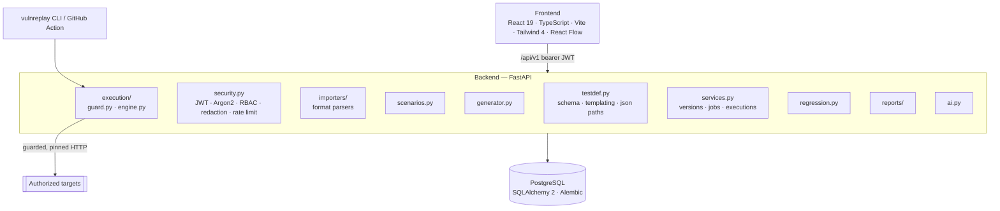
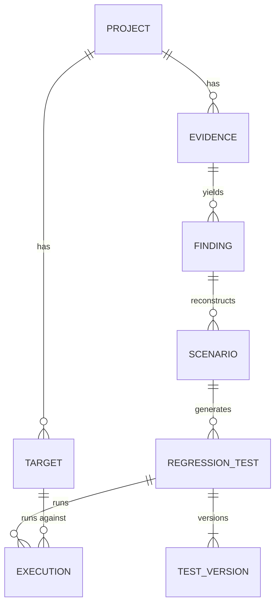
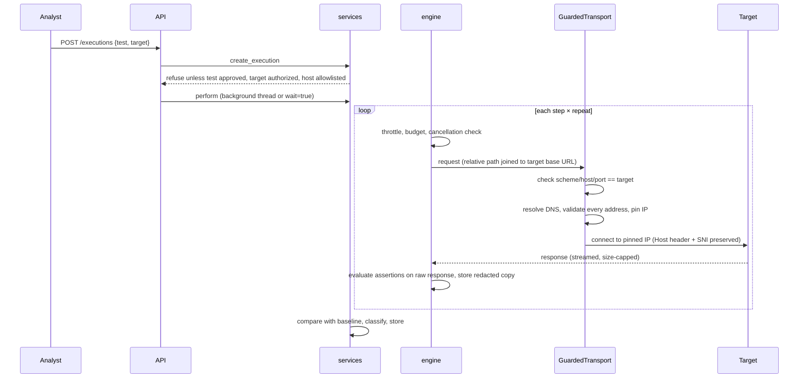
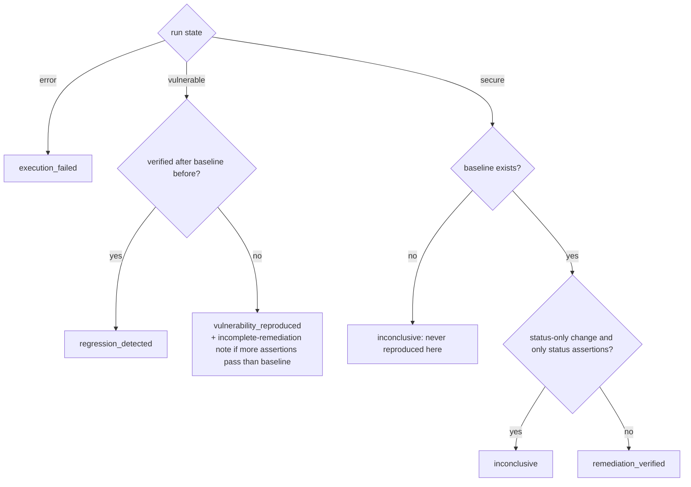

# Architecture

## Components

| Path | Responsibility |
| --- | --- |
| `backend/vulnreplay/config.py` | Settings from `VULNREPLAY_*` env vars; refuses unsafe production config |
| `backend/vulnreplay/models.py` | ORM: users, projects, targets, evidence, findings, scenarios, tests + versions, executions, audit events |
| `backend/vulnreplay/importers/` | Format detection, parsing, sanitization, fingerprinting, provenance |
| `backend/vulnreplay/scenarios.py` | `AttackScenario` model and deterministic reconstruction |
| `backend/vulnreplay/testdef.py` | Test definition schema (the executable artifact), safe templating, JSON paths |
| `backend/vulnreplay/generator.py` | Scenario → definition; definition → pytest / Playwright code |
| `backend/vulnreplay/execution/guard.py` | `TargetGuard` and `GuardedTransport` (SSRF / DNS rebinding defences) |
| `backend/vulnreplay/execution/engine.py` | Step runner: throttling, budgets, extraction, assertions, redirects, cancellation |
| `backend/vulnreplay/regression.py` | Result comparison and classification |
| `backend/vulnreplay/reports/` | Report model, Jinja2 HTML (autoescaped), fpdf2 PDF |
| `backend/vulnreplay/ai.py` | Deterministic assistant + optional grounded local LLM |
| `backend/vulnreplay/api/` | REST routers |
| `backend/vulnreplay/cli.py` | CI entry point |
| `lab/demo_app/` | Deliberately vulnerable / partial / patched demo application |

## Data model

* **Evidence** stores the original bytes (`original`), the normalized exchanges, SHA-256 and provenance.
  This includes the parser metadata and a hash per exchange.
* **RegressionTest** has an approval status. Every new **TestVersion** resets the status to `draft`.
* **Execution** stores the pinned test version, the redacted result, the classification, an `is_baseline`
  flag and the comparison with its reasons.

## Request lifecycle of an execution

## Classification logic

The first `vulnerability_reproduced` run of a test becomes its **baseline** automatically. An analyst can
choose a different baseline with `POST /executions/{id}/baseline`.

## Frontend

A single-page app with eleven routes (Overview, Projects, Findings, Evidence, Scenarios, Test Generator,
Test Execution, Regression Library, Comparison Reports, CI/CD, Settings). Every number shown comes from the
API. The JWT is kept in `sessionStorage` and sent as a bearer header; no cookies are used, so the API is not
exposed to CSRF. React Flow draws attack sequences. All evidence is rendered as text nodes, never as HTML.
