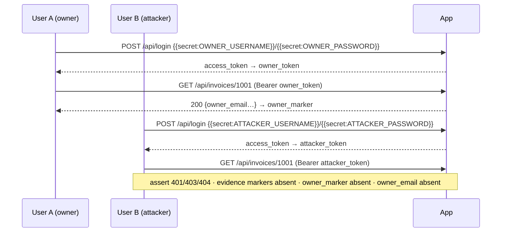

# Attack scenarios

An **attack scenario** is VulnReplay's structured, evidence-grounded description of how a vulnerability was
exercised and what secure behaviour looks like. It is built deterministically from imported exchanges by
`vulnreplay/scenarios.py`.

## Scenario fields

| Field | Meaning |
| --- | --- |
| `scenario_id` | Stable identifier (`scn_…`) |
| `category` | One of the categories below |
| `target_endpoint`, `method` | The request that demonstrated the issue |
| `authentication_context` | Detected auth type (bearer, cookie session, API key, none) and principal. Credentials are always replaced with placeholders. |
| `preconditions` | Authorization, synthetic data, required secrets, account relationships |
| `request_sequence` | Ordered steps with actor, purpose, method, path and evidence reference |
| `expected_behavior` / `observed_behavior` | Secure expectation vs what the evidence shows |
| `evidence_references` | `evidence_id#exchange_index` for each step |
| `reproduction_instructions` | Human-readable steps |
| `risk_assessment` | Severity, impact text (OWASP-mapped), CWE |
| `secure_expectations` | Assertions the generated test will enforce |
| `sensitive_markers` | Values from the original response that must not be exposed again |
| `review_notes` | Things a reviewer must look at (excluded destructive payloads, missing markers) |

## Supported categories and generated expectations

| Category | Secure expectation generated | Notes |
| --- | --- | --- |
| `idor` / `broken_access_control` / `authorization_bypass` | Status in 401/403/404, **each leaked sensitive value absent**, sensitive top-level fields absent | With `auth_mode=login_flow` a 4-step owner/attacker flow is built (below) |
| `authentication_failure` | Status 401/403 with credentials removed from the probe; protected data absent | |
| `sql_injection` | No HTTP 500 and no database error signatures (SQLite, PostgreSQL, Oracle, MSSQL, generic SQLSTATE) | Verification only. Destructive payloads are excluded and the original benign probe is replayed. |
| `input_validation` | Invalid input rejected with 400/422 | |
| `security_headers` | Each header missing from the original response is present | Defaults to HSTS, CSP, nosniff, frame options, referrer policy |
| `rate_limiting` | At least one 429 within a bounded burst (default 20, max 100) | A logged burst is replayed as one repeated request |
| `cors_misconfiguration` | An untrusted origin (`https://untrusted-origin.vulnreplay.invalid`) is not reflected and `*` is not used | |
| `session_management` | Session cookie has `HttpOnly` and `SameSite` | |
| `other` | No 500. Flagged for manual review. | |

## Multi-step authorization replay



The two setup steps double as **preconditions**. If the owner can't read their own resource, the run is
`execution_failed`, not a false "remediation verified".

## Demo lab scenarios

`lab/demo_app/app.py` exposes every category in three modes. All data is synthetic
(`*@lab.vulnreplay.test`).

| Endpoint | Vulnerable | Partial | Patched |
| --- | --- | --- | --- |
| `GET /api/invoices/{id}` | Any user reads any invoice (IDOR) | 403 **with the invoice in the body** | 404 for foreign invoices |
| `GET /api/admin/users` | Any authenticated user | Admin only | Admin only |
| `POST /api/password-reset` | Unlimited | 429 after 5/min | 429 after 5/min |
| `GET /api/products?q=` | String-built SQL, leaks `sqlite3.OperationalError` | Parameterized | Parameterized |
| any route | Reflects `Origin` with credentials; no security headers | Allowlisted origins; headers set | Allowlisted origins; headers set |

Sample evidence for each lives in `samples/`.

## Writing scenarios by hand

You can also create tests directly with `POST /projects/{id}/tests` and a definition:

```json
{
  "schema_version": "1",
  "id": "vr-custom-admin-export",
  "name": "Export endpoint requires admin",
  "category": "authorization_bypass",
  "secrets": ["VIEWER_TOKEN"],
  "steps": [{
    "id": "probe", "role": "probe",
    "request": {"method": "GET", "path": "/api/export", "headers": {"Authorization": "Bearer {{secret:VIEWER_TOKEN}}"}},
    "assert_secure": [
      {"type": "status_in", "values": [403], "description": "viewer is denied"},
      {"type": "body_not_contains", "value": "@", "description": "no e-mail addresses exported"}
    ]
  }]
}
```

Available assertion types: `status_in`, `status_not_in`, `sequence_any_status_in`, `body_contains`,
`body_not_contains`, `json_path_present`, `json_path_absent`, `json_path_equals`, `json_path_not_equals`,
`header_present`, `header_absent`, `header_equals`, `header_not_equals`, `header_contains`, `max_duration_ms`.
