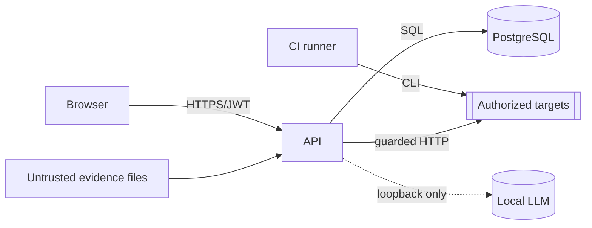

# Threat model

VulnReplay holds sensitive security evidence and can send HTTP requests. That makes it attractive both as a
data source and as an SSRF pivot. This model follows STRIDE per trust boundary.

## Assets

* Imported evidence (may contain captured credentials, PII and internal URLs)
* Test credentials (`VULNREPLAY_SECRET_*`)
* The ability to send requests from the backend's network position
* Integrity of results and reports (used as proof of remediation)
* User accounts and the JWT signing key

## Trust boundaries

## Threats and mitigations

| # | Threat (STRIDE) | Mitigation | Verified by |
| --- | --- | --- | --- |
| T1 | **SSRF:** a user points execution at internal services or cloud metadata (I, E) | Two gates: host must be in operator `VULNREPLAY_ALLOWED_HOSTS` *and* the target must be authorized by an admin. Paths are relative only. Link-local, metadata, multicast, CGNAT and unspecified ranges are always blocked. Private and loopback ranges are blocked unless the target is local or explicitly flagged. | `test_guard.py`, `test_api.py::test_target_validation_blocks_external_hosts` |
| T2 | **DNS rebinding:** host resolves to a public IP at check time, internal IP at connect time (E) | Every request re-resolves, validates *all* returned addresses and connects to the pinned IP with the original Host header and SNI | `test_transport_revalidates_every_request_and_pins_ip`, `test_dns_rebinding_to_private_or_loopback_blocked` |
| T3 | **Open redirect to internal host** (E) | Redirects are not followed by default. When enabled, every hop must stay on the same scheme, host and port. | `test_redirect_to_unapproved_destination_is_not_followed` |
| T4 | **Malicious evidence upload:** XXE, billion laughs, pickle, archives, huge files (T, D, E) | defusedxml, magic-byte blocklist, 5 MB limit enforced while reading, JSON/UTF-8 validation, exchange count cap, control characters stripped. Nothing is executed or deserialized beyond JSON/XML. | `test_importers.py`, `test_upload_restrictions` |
| T5 | **Stored XSS through evidence** (T) | React renders evidence as text. HTML reports use Jinja2 autoescape and are served with `default-src 'none'`. The original-evidence download is `application/octet-stream` + attachment + nosniff. | frontend `renders evidence as inert text`, `test_evidence_view_redacts_credentials` |
| T6 | **Credential exposure** in evidence, generated tests, logs, reports, CI output (I) | Captured auth headers are replaced by `{{secret:NAME}}`. Secrets are read only from env at run time. Results, logs, JSON, SARIF and reports are redacted (header names, known secret values, extracted tokens, JWT/bearer patterns). Target variables named like secrets are refused. | `test_secrets_never_appear_in_results`, `test_idor_full_regression_lifecycle`, CLI test |
| T7 | **Destructive or abusive testing** (D, T) | Closed assertion set, destructive payload patterns rejected, `safety.destructive` unsupported, per-test and global request budgets, throttling, response size cap, cancellation | `test_destructive_payloads_rejected`, `test_request_budget_and_cancellation` |
| T8 | **AI-generated test does something unexpected** (T, E) | AI output is validated against the same schema, may only use endpoints present in the scenario, is stored as `origin=ai`, `draft`, and needs human approval. The LLM endpoint must be loopback. | `ai.py`, approval gate in `create_execution` |
| T9 | **AI fabricates success** (R) | Assistant only receives redacted evidence and results. Claimed facts without quotes found in the evidence are downgraded to hypotheses. Classifications come only from the engine. | `ai.py::_ground` |
| T10 | **Broken authentication / brute force** (S) | Argon2id hashing, ≥10-character passwords, generic login errors with constant-work dummy verification, per-IP login rate limit, HS256 JWT with issuer and expiry, `alg=none` rejected | `test_api.py` auth tests |
| T11 | **Privilege escalation** (E) | RBAC (viewer < analyst < admin) on every route. Only admins authorize targets or manage users. Admins can't demote themselves. | `test_rbac`, `test_admin_cannot_demote_self` |
| T12 | **SQL injection in VulnReplay** (T) | SQLAlchemy ORM with bound parameters only | `test_sql_injection_in_filters_is_harmless` |
| T13 | **CSRF** (S) | No cookie authentication: bearer tokens in an `Authorization` header only. CORS restricted to configured origins with `allow_credentials=False`. | `test_cors_only_allows_configured_origins` |
| T14 | **Tampering with results or reports** (T, R) | Evidence SHA-256 at import, per-exchange hashes, definition hash, result hashes and report hash in every report. Audit log of security-relevant actions. Executions pin the test version. | report tests |
| T15 | **Resource exhaustion of VulnReplay** (D) | Upload size cap, exchange cap, API rate limit, response size cap, execution budgets | API and guard tests |
| T16 | **Weak production configuration** (S) | Production mode refuses the default or short `SECRET_KEY` and wildcard CORS | `test_production_refuses_default_secret` |
| T17 | **Demo lab exposure** (E) | The lab is on an internal Docker network with no published ports and only synthetic data. Documented as deliberately vulnerable. | `docker-compose.yml` |

## Residual risks

* An administrator can authorize any host the operator allowlisted. Keep the allowlist minimal.
* In-process rate limiting doesn't coordinate across replicas.
* Evidence is stored unencrypted in the database. Use database or disk encryption for sensitive deployments.
* Redaction is pattern-based. A secret in an unusual format inside a response body could survive unless it
  was supplied as a `VULNREPLAY_SECRET_*` value (those are always redacted).
